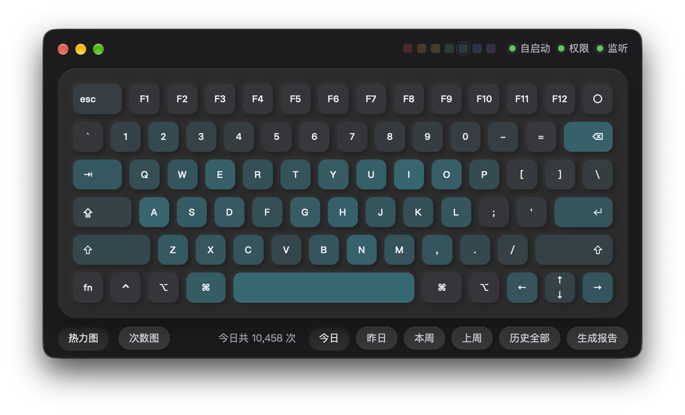

# Awesome Keyboard Heatmap

面向 macOS 的键盘使用可视化工具，以 MacBook Pro 风格配列呈现按键频率与次数。支持七色主题、系统深色模式和本地统计。

<p align="center">
  
  
</p>

[下载安装](#下载安装) · [功能特性](#功能特性) · [体验改进](#体验改进) · [数据与隐私](#数据与隐私) · [开发与构建](#开发与构建)

## 下载安装

[下载 macOS 通用安装包](https://github.com/koreyzen/awesome-keyboard-heatmap/releases/latest/download/Keyboard-Heatmap-v1.1.2-macOS-universal.zip) · [查看版本说明](https://github.com/koreyzen/awesome-keyboard-heatmap/releases/latest)

安装包同时支持 Apple 芯片和 Intel Mac。

1. 解压 ZIP，将 `Keyboard Heatmap.app` 拖入「应用程序」。
2. 启动应用，在「系统设置 → 隐私与安全性 → 辅助功能」中开启 Keyboard Heatmap。

应用采用固定本地证书签名，未经过 Apple 公证。若系统阻止首次打开，可在「系统设置 → 隐私与安全性」中允许打开。

## 功能特性

### 键盘布局与系统外观保持一致

MacBook Pro 风格的紧凑 ANSI 配列采用统一键宽比例，配合苹方字体与统一线条图标。窗口固定为 780 × 429，顶部控件避开 macOS 窗口控制区。

界面随系统自动切换深浅色，键帽、热力颜色、文字、按钮、悬浮提示和报告弹窗同步适配。七种主题色可在顶部切换，悬停时仅高亮当前色块。

### 热力分布与按键次数支持叠加查看

「热力图」展示使用频率，「次数图」将键帽文字切换为次数，两者可独立开启或叠加。悬停按键即可查看对应次数，提示固定在键位上方，以 0.3 秒淡入淡出。

今日、昨日、本周、上周和历史全部支持一键切换，当前范围总计始终显示。统计在批量写入后自动刷新，跨天后自动更新日期。「生成报告」可生成并复制用于分析键盘使用情况的提示词。

### 关闭窗口后继续后台统计

应用通过 Dock 打开，不占用菜单栏托盘位置。关闭窗口后继续统计，点击 Dock 图标可重新打开；支持开机自启动。

## 体验改进

本项目基于 [zxc7563598/key-heat](https://github.com/zxc7563598/key-heat)，主要围绕 macOS 的布局、外观和统计交互进行改进。

<table>
  <thead>
    <tr><th nowrap>功能</th><th nowrap>原工程</th><th nowrap>Awesome Keyboard Heatmap</th></tr>
  </thead>
  <tbody>
    <tr><td nowrap>键盘配列</td><td nowrap>完整键盘</td><td nowrap>MacBook Pro 紧凑配列</td></tr>
    <tr><td nowrap>系统外观</td><td nowrap>浅色界面</td><td nowrap>随系统切换深浅色</td></tr>
    <tr><td nowrap>热力配色</td><td nowrap>单一红色</td><td nowrap>七色柔和主题</td></tr>
    <tr><td nowrap>统计视图</td><td nowrap>基础、热力图</td><td nowrap>热力与次数独立叠加</td></tr>
    <tr><td nowrap>日期筛选</td><td nowrap>手动选择日期</td><td nowrap>五种快捷范围</td></tr>
    <tr><td nowrap>次数总计</td><td nowrap>查看各键次数</td><td nowrap>当前范围自动汇总</td></tr>
    <tr><td nowrap>数据刷新</td><td nowrap>手动触发</td><td nowrap>批量写入后自动更新</td></tr>
    <tr><td nowrap>悬浮提示</td><td nowrap>随鼠标移动</td><td nowrap>固定键位、淡入淡出</td></tr>
    <tr><td nowrap>窗口布局</td><td nowrap>可调节宽屏</td><td nowrap>紧凑窗口、苹方字体</td></tr>
    <tr><td nowrap>按键细节</td><td nowrap>独立字形与方向键</td><td nowrap>统一图标、合并上下键</td></tr>
    <tr><td nowrap>应用入口</td><td nowrap>托盘菜单</td><td nowrap>Dock 入口、后台统计</td></tr>
  </tbody>
</table>

## 数据与隐私

按键数据以「日期 + 按键名称 + 次数」聚合，保存在本机 SQLite 中，不保存输入文本或按键顺序。主题偏好也保存在本机，切换主题无需查询数据库。

每 10 秒或累计 500 次按键合并为一个批次，在一次数据库事务中提交。窗口隐藏或最小化时继续计数，暂停按键动画通知。界面总计为当前配列内各键次数之和；外接键盘独有的按键不计入这张配列的总计。

macOS 数据文件位于：

```text
~/Library/Application Support/KeyHeat/keyheat.db
```

## 开发与构建

### 本地构建 macOS 应用

准备 Go 1.25+、Node.js 22 和 Xcode Command Line Tools，然后执行：

```bash
git clone https://github.com/koreyzen/awesome-keyboard-heatmap.git
cd awesome-keyboard-heatmap
go install github.com/wailsapp/wails/v3/cmd/wails3@v3.0.0-alpha.74
export PATH="$(go env GOPATH)/bin:$PATH"
npm --prefix frontend ci
wails3 task darwin:package
```

构建产物为 `bin/Keyboard Heatmap.app`。安装与授权方式见上方「下载安装」。仓库保留原工程的 Windows 构建支持，界面适配以 macOS 为主。

### 持续更新复用固定签名

本地开发可以使用钥匙串中的固定代码签名证书：

```bash
KEY_HEAT_SIGN_IDENTITY="你的代码签名证书名称" wails3 task darwin:package
```

保持签名身份、应用标识和安装路径一致，可减少更新后重复授予辅助功能权限的情况。

## 项目来源与许可证

感谢何俊杰创建的 [Key Heat](https://github.com/zxc7563598/key-heat)。本项目由 [koreyzen](https://github.com/koreyzen) 维护，保留原工程历史与版权声明，继续采用 [MIT License](LICENSE)。
